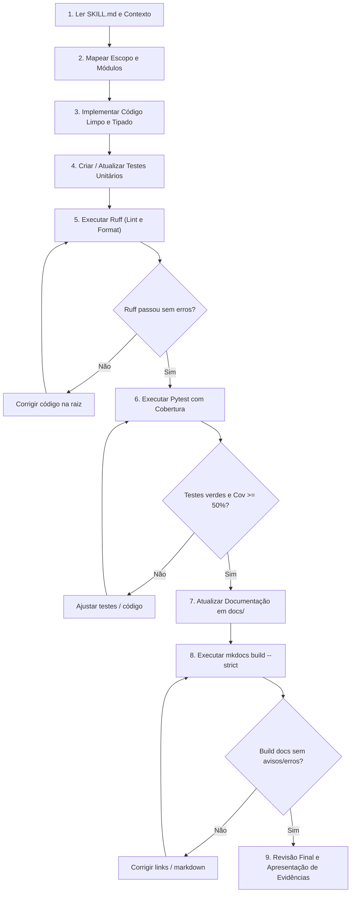

# SKILL: Engenharia de Dados com Python — Padrões e Práticas Obrigatórias

**Status**: Obrigatório / Fonte Única da Verdade (SSOT)  
**Público-alvo**: Engenheiros de Dados, Desenvolvedores de Software e Agentes de IA  
**Versão do Python**: `>= 3.12`  
**Ferramental Oficial**: Poetry, Ruff, Pytest, Pytest-cov, MkDocs Material  

---

## 1. Princípios Gerais de Engenharia de Software e Dados

Todo o código desenvolvido, mantido ou revisado neste projeto deve obedecer rigorosamente aos seguintes princípios de engenharia:

1. **Simplicidade e Legibilidade em Primeiro Lugar (KISS)**:
   - Escreva código legível, expressivo e autoexplicativo.
   - Evite "espertezas", truques de sintaxe de uma linha ou metaprogramação que obscureçam a intenção do código.
   - O código é lido com muito mais frequência do que é escrito.

2. **Modularidade e Separação Estrita de Responsabilidades (SoC)**:
   - Cada módulo, classe e função deve ter um propósito único e bem delimitado.
   - Separe de forma inegociável:
     - Configurações e variáveis de ambiente;
     - Acesso a I/O (APIs, bancos de dados, data lakes, arquivos);
     - Regras de negócio e transformações de dados;
     - Orquestração de pipelines e pontos de entrada (*entrypoints*).

3. **Baixo Acoplamento e Alta Coesão**:
   - Módulos internos devem interagir por meio de contratos de dados (schemas, dataclasses, tipagem explícita), sem depender do estado interno uns dos outros.
   - Modificações em conectores ou fontes externas não devem forçar alterações nas regras de transformação analítica.

4. **Reutilização Pragmática sem Complexidade Acidental (YAGNI & DRY)**:
   - Reutilize código padronizando rotinas utilitárias genéricas, mas não crie abstrações prematuras ou hierarquias complexas de classes sem necessidade comprovada.
   - Não implemente funcionalidades, parâmetros ou frameworks sem uma justificativa técnica concreta e imediata.

5. **Tratamento Explícito de Erros e Exceções**:
   - Falhas devem ser capturadas e tratadas no nível arquitetural adequado.
   - Proibido o uso de `except Exception: pass` ou captura genérica sem log ou re-lançamento (*fail-fast*).
   - Defina e lance exceções de domínio específicas quando uma operação de dados violar as premissas de negócio.

6. **Tipagem Estática Obrigatória (*Type Hints*)**:
   - Toda assinatura de função pública (parâmetros e retorno) deve possuir type hints explícitos (`typing`, `collections.abc`).
   - Utilize ferramentas de verificação estática para garantir a conformidade dos dados.

7. **Nomes Descritivos e Semânticos (PEP 8)**:
   - Funções e métodos: verbos no infinitivo descrevendo a ação (`fetch_driver_telemetry`, `clean_lap_times`, `load_to_parquet`).
   - Variáveis: substantivos claros (`driver_records`, `circuit_mapping`, `retry_interval_seconds`). Evite abreviações crípticas (`df1`, `x`, `tmp`, `d`).
   - Constantes: `UPPER_SNAKE_CASE`.
   - Classes: `PascalCase`.

8. **Funções Pequenas e Focadas**:
   - Funções devem fazer uma única coisa e fazê-la bem.
   - Mantenha funções preferencialmente com menos de 30 a 50 linhas de código executável. Se uma função lida com I/O, validação, limpeza e escrita, quebre-a em funções especializadas.

9. **Universalidade**:
   - Estes princípios aplicam-se a todo o espectro do projeto: scripts de extração, conectores de API, transformações tabulares, pipelines batch ou streaming, bibliotecas compartilhadas e testes automatizados.

---

## 2. Gerenciamento de Ambiente e Dependências com Poetry

O **Poetry** é a ferramenta oficial e **exclusiva** para gerenciamento de dependências, resolução de ambientes virtuais e empacotamento do projeto.

### 2.1. Regras Obrigatórias e Inegociáveis

1. **Proibição Estrita do `pip`**:
   - **NUNCA** execute `pip install` para instalar dependências do projeto, bibliotecas de teste ou utilitários. Nem manualmente, nem via scripts, nem como tentativa de contorno.
   - **NUNCA** instale pacotes globalmente no ambiente do sistema operacional.
2. **Ambiente Gerenciado pelo Poetry**:
   - Todas as ferramentas de linha de comando (`pytest`, `ruff`, `mkdocs`, `python`) devem ser executadas através do Poetry: `poetry run <comando>`.
   - Não crie ambientes virtuais paralelos manuais via `venv`, `virtualenv` ou `conda`. O Poetry gerencia o ciclo de vida da `.venv`.
3. **Reprodutibilidade Estrita**:
   - O arquivo `poetry.lock` é sagrado e **deve ser versionado no Git**.
   - Atualizações de versões de pacotes só ocorrem de forma intencional e controlada via `poetry update <pacote>`.
4. **Segregação de Dependências por Grupos**:
   - Dependências de execução (runtime de produção) ficam na seção principal de dependências.
   - Dependências de desenvolvimento e testes ficam no grupo `dev` (`[tool.poetry.group.dev.dependencies]`).
   - Dependências de documentação técnica ficam no grupo `docs` (`[tool.poetry.group.docs.dependencies]`).

### 2.2. Tabela de Comandos Oficiais

| Ação | Comando Oficial |
| :--- | :--- |
| Instalar ambiente a partir de clone limpo | `poetry install` |
| Instalar apenas dependências de produção | `poetry install --only main` |
| Adicionar dependência de produção | `poetry add <pacote>` |
| Adicionar dependência com restrição de versão | `poetry add "<pacote>@^1.2.0"` |
| Adicionar dependência de desenvolvimento | `poetry add --group dev <pacote>` |
| Adicionar dependência de documentação | `poetry add --group docs <pacote>` |
| Remover dependência de produção | `poetry remove <pacote>` |
| Remover dependência de um grupo específico | `poetry remove --group dev <pacote>` |
| Executar qualquer script ou módulo | `poetry run python -m <modulo>` |
| Inspecionar o ambiente virtual ativo | `poetry env info` |
| Obter o caminho do executável Python | `poetry run which python` |

### 2.3. Workflow de Setup: Do Clone Limpo ao Ambiente Operacional

Ao clonar o repositório pela primeira vez ou ao iniciar um novo container/agente de trabalho:

```bash
# 1. Garanta que o Poetry esteja disponível e verifique sua versão
poetry --version

# 2. Instale todas as dependências declaradas e respeitando o poetry.lock
poetry install

# 3. Valide se o ambiente virtual foi criado e associado ao projeto
poetry env info

# 4. Confirme que o Python utilizado é >= 3.12
poetry run python --version
```

---

## 3. Arquitetura Modular com `src/` Layout

O projeto adota a arquitetura de **Layout `src/`**. O pacote Python principal reside obrigatoriamente sob `src/f1` (ou `src/<nome_do_projeto>`).

### 3.1. Por que `src/` Layout?
- **Isolamento de Importação**: Impede que o Python importe acidentalmente o diretório de trabalho local em vez do pacote formalmente instalado, prevenindo testes com falsos positivos.
- **Empacotamento Garantido**: Assegura que o pacote seja instalado e referenciado exatamente como será distribuído ou executado em produção.

### 3.2. Estrutura Canônica de Referência

```text
projeto/
├── pyproject.toml              # Metadados, dependências e configurações das ferramentas
├── poetry.lock                 # Lockfile com resolução exata de dependências
├── .gitignore                  # Arquivos e pastas ignorados pelo controle de versão
├── README.md                   # Apresentação do projeto e instruções gerais
├── SKILL.md                    # Fonte única de verdade de engenharia e boas práticas
├── mkdocs.yml                  # Configuração da documentação técnica MkDocs
├── src/
│   └── f1/                     # Pacote Python principal da aplicação
│       ├── __init__.py         # Inicializador do pacote e exportações explícitas
│       ├── config/             # Configurações de ambiente, URLs base, leitura de .env
│       │   ├── __init__.py
│       │   └── settings.py
│       ├── domain/             # Entidades de dados, modelos de domínio, contratos e schemas
│       │   ├── __init__.py
│       │   └── models.py
│       ├── connectors/         # Clientes de I/O puro: APIs REST, bancos de dados, arquivos
│       │   ├── __init__.py
│       │   └── openf1_client.py
│       ├── transformations/    # Funções puras de transformação, limpeza e validação de dados
│       │   ├── __init__.py
│       │   └── telemetry.py
│       ├── services/           # Regras de negócio integrando conectores e transformações
│       │   ├── __init__.py
│       │   └── telemetry_service.py
│       ├── pipelines/          # Pontos de entrada executáveis de orquestração de dados
│       │   ├── __init__.py
│       │   └── run_telemetry_pipeline.py
│       └── utils/              # Funções utilitárias puramente técnicas (datas, formatação, loggers)
│           ├── __init__.py
│           └── logging_utils.py
├── tests/
│   ├── __init__.py
│   ├── conftest.py             # Fixtures globais do pytest, mocks de HTTP e dados sintéticos
│   ├── unit/                   # Testes unitários puros (sem I/O, rápidos, determinísticos)
│   │   ├── __init__.py
│   │   ├── test_transformations.py
│   │   └── test_connectors.py
│   └── integration/            # Testes de integração entre componentes
│       └── __init__.py
└── docs/
    ├── index.md                # Página inicial da documentação técnica
    ├── arquitetura.md          # Detalhamento arquitetural e fluxo de dados
    ├── conectores.md           # Especificação das integrações externas (APIs, DBs)
    └── pipelines.md            # Guia de execução dos pipelines de dados
```

> [!IMPORTANT]
> **Regra da Não-Proliferação de Camadas Fictícias**: A estrutura acima é de referência conceitual. **Não crie pastas vazias nem camadas desnecessárias** se o projeto ainda não necessita delas. Inicie com os módulos necessários (ex: `connectors/` e `transformations/`) e adicione subpastas apenas quando houver arquivos concretos para povoá-las.

### 3.3. Regras de Isolamento e Fronteiras Modulares

1. **Direção Unidirecional de Dependências**:
   - `pipelines` consom `services` e `connectors`.
   - `services` orquestram `connectors`, `transformations` e `domain`.
   - `transformations` operam sobre objetos de `domain` ou estruturas tabulares e **NUNCA importam `connectors`, `services` ou `pipelines`**.
   - `domain` define schemas e contratos, sem depender de nenhuma outra camada do projeto.
2. **Transformações Puras (Zero I/O)**:
   - Funções de transformação de dados devem ser funções puras: recebem dados (ex: `list[dict]`, objetos de modelo ou dataframes), transformam-nos de forma determinística e retornam novos dados.
   - Proibido realizar chamadas de rede (`requests`, `httpx`), queries a banco ou leituras de disco dentro de funções em `transformations/`.
3. **Conectores Isolados (Apenas I/O e Comunicação)**:
   - Os módulos em `connectors/` são responsáveis por encapsular detalhes de protocolo (HTTP, SQL, S3, filesystem), timeouts, autenticação e retries.
   - Conectores não contêm lógica analítica de negócios; eles extraem ou persistem dados brutos ou normalizados.
4. **Ausência de Efeitos Colaterais na Importação (*Import-Safe*)**:
   - A importação de qualquer módulo (`import f1.transformations`) deve ser imediata e sem efeitos colaterais.
   - Proibido abrir conexões com bancos, ler arquivos pesados ou disparar requisições HTTP no corpo global dos arquivos (fora de funções ou métodos).
5. **Configuração no `pyproject.toml`**:
   - O Poetry deve mapear explicitamente o pacote `src`:
     ```toml
     [tool.poetry]
     packages = [{include = "f1", from = "src"}]
     ```

### 3.4. Matriz de Decisão: Onde Alocar Novo Código?

| Cenário / Necessidade | Decisão Arquitetural | Onde Criar / Modificar |
| :--- | :--- | :--- |
| Conectar a um novo endpoint de API ou tabela de banco | Novo conector ou método de conector | `src/f1/connectors/` |
| Filtrar, converter tipos, calcular métricas ou limpar dados | Função pura com type hints | `src/f1/transformations/` |
| Orquestrar: buscar na API, transformar e persistir no disco/banco | Serviço de negócio ou pipeline | `src/f1/services/` ou `src/f1/pipelines/` |
| Modelar campos de retorno, schema de validação | Modelo ou contrato de dados | `src/f1/domain/` |
| Helper genérico (ex: formatador de timestamp ISO 8601) | Função utilitária pura | `src/f1/utils/` |
| Código ultrapassou 200 linhas ou possui mais de uma responsabilidade | Decompor em funções menores ou novo módulo | Quebrar o módulo mantendo contratos |

---

## 4. Qualidade de Código e Formatação com Ruff

O **Ruff** é a ferramenta oficial e centralizada para *linting*, análise estática, modernização de sintaxe e formatação de todo o código-fonte (`src/` e `tests/`).

### 4.1. Linter (`ruff check`) vs. Formatador (`ruff format`)

- **`ruff check` (Linter)**: Analisa a Árvore Sintática Abstrata (AST) para identificar bugs em potencial, variáveis não utilizadas, violações de complexidade, modernizações de sintaxe recomendadas e organiza a ordem dos imports (`isort`).
- **`ruff format` (Formatador)**: Aplica um estilo visual opinativo e determinístico (comprimento de linhas, aspas duplas, indentação de 4 espaços, quebras de linhas consistentes).
- **Atenção**: `ruff format` **NÃO** substitui `ruff check`. Ambos devem ser executados e ambos devem passar sem erros.

### 4.2. Regras Configuradas no `pyproject.toml`

O projeto mantém ativas as seguintes famílias de regras no `pyproject.toml`:

- `E` / `W`: Erros e avisos de estilo do Pycodestyle (PEP 8).
- `F`: Verificações do Pyflakes (imports não utilizados, variáveis indefinidas, referências inválidas).
- `I`: Ordenação e agrupamento determinístico de imports (`isort`).
- `B`: Detecção de bugs e armadilhas comuns (`flake8-bugbear`), como argumentos padrão mutáveis em funções.
- `C4`: Otimização de list, dict e set comprehensions (`flake8-comprehensions`).
- `UP`: Modernização automática de sintaxe para Python 3.12+ (`pyupgrade`).
- `SIM`: Simplificação de estruturas de código (`flake8-simplify`).
- `TCH`: Otimização de tipagem com imports em `if TYPE_CHECKING:` (`flake8-type-checking`).
- `RUF`: Regras exclusivas e otimizações do motor do Ruff.

### 4.3. Tratamento de Violações e Supressões

1. **Correção Obrigatória na Origem**:
   - Se o linter reportar uma violação, corrija o código na raiz do problema.
   - Não oculte erros renomeando variáveis para `_` indiscriminadamente ou ignorando avisos legítimos.
2. **Proibição de `# noqa` Desenfreado**:
   - É terminantemente proibido inserir `# noqa` para contornar checagens de tipos, variáveis não utilizadas ou complexidade.
   - Caso uma exceção pontual seja estritamente indispensável (exemplo: re-exportação proposital de símbolo em `__init__.py`), restrinja ao menor escopo possível e declare a regra específica com justificativa:
     ```python
     # Permitido apenas quando estritamente intencional
     from f1.connectors.openf1_client import OpenF1Client as OpenF1Client  # noqa: F401
     ```

### 4.4. Comandos de Execução e Validação

```bash
# 1. Executar o linter e verificar violações em todo o projeto
poetry run ruff check .

# 2. Corrigir automaticamente violações seguras identificadas pelo linter
poetry run ruff check . --fix

# 3. Organizar e ordenar os imports explicitamente
poetry run ruff check . --select I --fix

# 4. Formatar o código-fonte de acordo com o estilo oficial
poetry run ruff format .

# 5. Modo estrito de verificação de formatação (utilizado no CI e como critério de conclusão)
poetry run ruff format --check .
```

**Critério de Conclusão**: O linter deve retornar `All checks passed!` e a verificação de formatação deve indicar que nenhum arquivo necessita de reformatar.

---

## 5. Testes Automatizados e Cobertura com Pytest e Pytest-cov

O framework oficial de testes é o **pytest**, em conjunto com o plugin **pytest-cov** para monitoramento e exigência de cobertura de código.

### 5.1. Regras Obrigatórias de Testes

1. **Toda funcionalidade nova deve nascer com testes unitários**:
   - Nenhuma função, conector, transformação ou classe deve ser considerada concluída sem testes unitários correspondentes.
2. **Cobertura Mínima Obrigatória de 50%**:
   - O projeto impõe um patamar **mínimo global de 50% de cobertura** das linhas executáveis dentro de `src/f1`.
   - O `pyproject.toml` está pré-configurado com `--cov-fail-under=50`. O comando `poetry run pytest` falhará automaticamente (código de saída diferente de 0) caso a cobertura caia abaixo deste limiar.
3. **Cobertura Não é Sinônimo de Qualidade (Proibição de Testes Artificiais)**:
   - Não crie testes "zumbis" que apenas executam funções sem fazer asserções rigorosas (`assert`) sobre o resultado.
   - Cada teste deve validar um comportamento real: valores retornados, integridade estrutural, campos esperados, status codes e exceções disparadas.
4. **Isolamento Total de I/O em Testes Unitários**:
   - Testes unitários **NÃO** devem depender de internet, conexões ativas com bancos de dados, chaves de API reais ou arquivos locais fixos de desenvolvedor.
   - Utilize a biblioteca padrão `unittest.mock` (`Mock`, `patch`) ou fixtures do pytest para simular respostas HTTP e conexões externas.
5. **Determinismo e Idempotência dos Testes**:
   - Os testes devem ser rápidos, independentes da ordem de execução e produzir o mesmo resultado em qualquer máquina.
6. **Mapeamento de Cenários**:
   - Cubra cenários felizes (*happy path*).
   - Cubra cenários de erro e exceções esperadas (`pytest.raises`).
   - Cubra limites e bordas (*edge cases*): coleções vazias, payloads incompletos, timestamps nulos, valores numéricos negativos.

### 5.2. Padrões de Implementação de Testes

#### Exemplo de Teste de Transformação Pura com Parametrização

```python
# tests/unit/test_telemetry.py
import pytest
from f1.transformations.telemetry import calculate_speed_kph

@pytest.mark.parametrize(
    ("speed_mps", "expected_kph"),
    [
        (0.0, 0.0),
        (10.0, 36.0),
        (50.0, 180.0),
        (88.8889, 320.0),
    ],
)
def test_calculate_speed_kph_valid_inputs(speed_mps: float, expected_kph: float) -> None:
    """Valida a conversão de metros por segundo para quilômetros por hora."""
    result = calculate_speed_kph(speed_mps)
    assert pytest.approx(result, rel=1e-2) == expected_kph


def test_calculate_speed_kph_raises_on_negative_speed() -> None:
    """Garante que velocidades físicas inválidas disparem exceção semântica."""
    with pytest.raises(ValueError, match="Velocidade não pode ser negativa"):
        calculate_speed_kph(-5.0)
```

#### Exemplo de Teste de Conector com Mock de Rede

```python
# tests/unit/test_openf1_client.py
from unittest.mock import MagicMock, patch
import pytest
from f1.connectors.openf1_client import OpenF1Client

@patch("f1.connectors.openf1_client.requests.get")
def test_fetch_sessions_success(mock_get: MagicMock) -> None:
    """Verifica se o cliente consome o endpoint de sessões e converte o payload."""
    mock_response = MagicMock()
    mock_response.status_code = 200
    mock_response.json.return_value = [
        {"session_key": 9222, "session_name": "Race", "year": 2023}
    ]
    mock_get.return_value = mock_response

    client = OpenF1Client(base_url="https://api.openf1.org/v1")
    sessions = client.fetch_sessions(year=2023)

    assert len(sessions) == 1
    assert sessions[0]["session_key"] == 9222
    mock_get.assert_called_once_with(
        "https://api.openf1.org/v1/sessions",
        params={"year": 2023},
        timeout=10,
    )
```

### 5.3. Comandos de Execução de Testes

```bash
# 1. Executar a suíte de testes padrão com validação automática de cobertura >= 50%
poetry run pytest

# 2. Executar testes exibindo detalhes de cada caso e linhas não cobertas
poetry run pytest -v --cov-report=term-missing

# 3. Executar apenas testes de uma pasta ou arquivo específico
poetry run pytest tests/unit/test_telemetry.py

# 4. Executar testes filtrando por nome de função
poetry run pytest -k "test_calculate_speed"
```

---

## 6. Boas Práticas Específicas de Engenharia de Dados

Pipelines de dados possuem requisitos operacionais distintos de softwares puramente transacionais. As seguintes diretrizes devem orientar todo o design de pipelines, conectores e transformações:

### 6.1. Ciclo de Vida do Dado e Separação de Fases (E-V-T-L)

1. **Extração (Extraction)**:
   - Conectores buscam os dados da origem (API externa, banco, arquivos).
   - Preocupe-se exclusivamente com transporte seguro, autenticação, paginação e paginação/lotes.
2. **Validação (Validation)**:
   - Antes de aplicar regras analíticas complexas, valide se os dados de entrada satisfazem o contrato mínimo (presença de colunas obrigatórias, formato de chaves, integridade de tipos).
   - Rejeite ou encaminhe registros defeituosos para quarentena (*Dead Letter Queue* ou logs estruturados), sem corromper o restante do lote.
3. **Transformação (Transformation)**:
   - Funções puras aplicam limpeza, conversão de formatos, cálculos derivados e agregações.
   - Garantir total **determinismo**: para os mesmos dados de entrada, a saída deve ser invariavelmente a mesma.
4. **Carga (Load / Persistence)**:
   - Escrita dos dados tratados no destino final (Parquet, banco analítico, PostgreSQL, DuckDB, Delta).

### 6.2. Eficiência de Memória e Gestão de Volume

1. **Não Carregue Conjuntos Massivos de Forma Indiscriminada**:
   - Evite `SELECT *` ou requisições HTTP sem filtros que tragam milhões de linhas para a memória RAM.
   - Utilize streams (`response.iter_lines()`), geradores Python (`yield`) ou leitura particionada (*chunking*) ao lidar com volumes significativos.
2. **Evite Cópias Desnecessárias em Memória**:
   - Evite chamadas repetidas a `.copy()` ou instanciação de múltiplas listas intermediárias idênticas.
   - Quando operar sobre listas de dicionários ou dataframes, encadeie as operações de forma limpa.

### 6.3. Idempotência e Reprocessamento Seguro

1. **Execuções Repetidas Devem Ser Inofensivas**:
   - Executar o mesmo pipeline duas ou mais vezes sobre a mesma janela de dados (ex: `data = 2024-03-10` ou `session_key = 9222`) **NÃO** deve duplicar registros no destino.
2. **Estratégias de Idempotência**:
   - *Overwrite Particionado*: Ao salvar dados em data lakes/Parquet, particione por data ou chave e sobrescreva a partição específica.
   - *Upsert / Merge*: Em bancos de dados relacionais ou analíticos, utilize comandos `UPSERT` baseados na chave primária de negócio.

### 6.4. Resiliência, Retries e Timeouts

1. **Timeouts Obrigatórios**:
   - **Toda chamada de rede ou I/O externo DEVE conter um timeout explícito**.
   - Nunca execute `requests.get(url)` sem o parâmetro `timeout=...`. Chamadas sem timeout podem bloquear a execução do pipeline indefinidamente.
2. **Retries com Backoff Exponencial**:
   - Para erros transientes de rede ou rate limits (HTTP 429, 502, 503, 504), aplique retries controlados com espera exponencial (`urllib3.util.retry`, `tenacity` ou lógica dedicada no conector).
   - Defina um teto máximo de tentativas (ex: 3 a 5 tentativas) para não criar loops infinitos.

### 6.5. SQL e Acesso Seguro a Bancos de Dados

1. **Parâmetros Obrigatórios contra SQL Injection**:
   - **NUNCA** concatene strings ou use f-strings para injetar variáveis dentro de instruções SQL.
   - Utilize sempre consultas parametrizadas fornecidas pelo driver do banco:
     ```python
     # CORRETO: Consulta parametrizada segura
     cursor.execute(
         "SELECT session_key, country FROM f1_sessions WHERE year = %s AND circuit = %s",
         (2023, "Monza"),
     )

     # PROIBIDO: Risco crítico de SQL Injection
     cursor.execute(f"SELECT * FROM f1_sessions WHERE year = {year}")  # NUNCA FAÇA ISSO
     ```
2. **Gerenciamento Seguro de Conexões e Recursos**:
   - Utilize sempre gerenciadores de contexto (`with`) para abrir e fechar conexões, cursores e arquivos, assegurando o fechamento adequado de handles mesmo em caso de erro.
   - Aplique transações atômicas (*commit* apenas ao final do lote com sucesso, *rollback* imediato em caso de falha).

### 6.6. Observabilidade e Sanitização de Logs

1. **Proibição do `print()`**:
   - É proibido o uso de `print()` para fins de log operacional de pipelines. Utilize o módulo nativo `logging` devidamente configurado.
2. **Níveis Semânticos de Log**:
   - `DEBUG`: Detalhes técnicos granulares para depuração (ex: URL completa requisitada, payloads parciais).
   - `INFO`: Marcos do pipeline (ex: "Iniciando extração da sessão 9222", "Lote de 5.000 registros gravado com sucesso").
   - `WARNING`: Anomalias recuperáveis (ex: "Registro com telemetria inconsistente descartado", "Tentativa 2/3 após falha temporária").
   - `ERROR`: Falhas críticas que interrompem a etapa ou o pipeline.
3. **Sanitização de Credenciais e Dados Sensíveis**:
   - **NUNCA** imprima nem registre em logs: senhas, tokens de autenticação, chaves de API, connection strings completas com senha ou dados confidenciais.

---

## 7. Documentação Técnica com MkDocs Material

O **MkDocs** com o tema **Material** é a ferramenta oficial do projeto para geração de documentação técnica, manuais de arquitetura, guias de APIs e referências de pipelines.

### 7.1. Regras Obrigatórias de Documentação

1. **Centralização em `docs/` e `mkdocs.yml`**:
   - A configuração da documentação reside exclusivamente no arquivo `mkdocs.yml` na raiz do repositório.
   - O conteúdo em Markdown reside no diretório `docs/`.
   - O arquivo `docs/index.md` é a porta de entrada obrigatória.
2. **Dependências no Grupo `docs`**:
   - `mkdocs` e `mkdocs-material` são gerenciados pelo Poetry no grupo `docs`.
3. **Atualização Contínua**:
   - Se uma alteração no código alterar parâmetros, adicionar novos pipelines, modificar modelos de dados ou criar novos conectores, a documentação técnica correspondente **DEVE ser atualizada no mesmo PR/tarefa**.
   - Proibido documentar funcionalidades planejadas como se já estivessem entregues.
4. **Build Estrito Obrigatório (`--strict`)**:
   - Todo ciclo de documentação deve ser validado com o sinalizador `--strict`.
   - O comando `poetry run mkdocs build --strict` trata qualquer link quebrado ou erro sintático como falha impeditiva.

### 7.2. Exemplo Canônico de `mkdocs.yml`

```yaml
site_name: Engenharia de Dados F1
site_description: Documentação técnica e arquitetural dos pipelines de dados da Fórmula 1
site_author: Equipe de Engenharia de Dados

theme:
  name: material
  language: pt-BR
  palette:
    - scheme: default
      primary: red
      accent: red
      toggle:
        icon: material/brightness-7
        name: Mudar para modo escuro
    - scheme: slate
      primary: red
      accent: red
      toggle:
        icon: material/brightness-4
        name: Mudar para modo claro
  features:
    - navigation.sections
    - navigation.expand
    - content.code.copy

nav:
  - Início: index.md
  - Arquitetura:
      - Visão Geral: arquitetura/visao_geral.md
      - Padrões de Dados: arquitetura/padroes_dados.md
  - Conectores:
      - OpenF1 API: conectores/openf1.md
  - Pipelines:
      - Telemetria: pipelines/telemetria.md
  - Guia de Desenvolvimento:
      - Setup e Comandos: desenvolvimento/setup.md
      - Qualidade e Testes: desenvolvimento/qualidade.md

markdown_extensions:
  - admonition
  - pymdownx.details
  - pymdownx.superfences
  - pymdownx.highlight:
      anchor_linenums: true
```

### 7.3. Comandos Oficiais de Documentação

```bash
# 1. Iniciar servidor local de desenvolvimento com hot-reload (disponível em http://127.0.0.1:8000)
poetry run mkdocs serve

# 2. Compilar a documentação estática em modo estrito (validação obrigatória de PRs)
poetry run mkdocs build --strict
```

---

## 8. Boas Práticas das Ferramentas e Sintaxe Python

Para garantir um código duradouro, eficiente e de fácil compreensão pela equipe, siga as seguintes práticas do ecossistema Python:

1. **Priorize a Biblioteca Padrão**:
   - Antes de adicionar uma nova dependência externa ao `pyproject.toml`, avalie se os módulos nativos do Python não são plenamente suficientes:
     - Manipulação de caminhos: `pathlib.Path` (proibido o uso arcaico de `os.path`).
     - Estruturação de dados: `dataclasses.dataclass` ou `typing.NamedTuple`.
     - Enumerações semânticas: `enum.Enum` ou `enum.StrEnum`.
     - Manipulação temporal: `datetime`, `zoneinfo`.
     - Interfaces abstratas: `abc.ABC` e `abc.abstractmethod`.
     - Utilitários funcionais: `functools`, `itertools`.
2. **Avaliação Criteriosa de Novas Dependências**:
   - Cada dependência externa representa um custo de manutenção, risco de segurança e complexidade de resolução.
   - Adicione dependências apenas se houver justificativa técnica evidente e economia significativa de esforço.
3. **Uso Moderno de `pathlib.Path`**:
   ```python
   # CORRETO: Idiomático, seguro e multiplataforma
   from pathlib import Path

   DATA_DIR = Path(__file__).resolve().parent.parent / "data"
   DATA_DIR.mkdir(parents=True, exist_ok=True)
   file_path = DATA_DIR / "laps.parquet"

   # PROIBIDO: Manipulação arcaica de strings de caminho
   import os
   file_path = os.path.join(os.path.dirname(__file__), "..", "data", "laps.parquet")
   ```
4. **Gerenciadores de Contexto para Recursos**:
   - Qualquer objeto que abra handles no sistema operacional (arquivos, sockets, conexões de banco) deve ser utilizado dentro de um bloco `with`:
   ```python
   with open(file_path, mode="w", encoding="utf-8") as file:
       file.write(data)
   ```
5. **Configurações Centralizadas e Fortemente Tipadas**:
   - Carregue variáveis de ambiente em uma classe de configuração dedicada no módulo `src/f1/config/settings.py`.
   - Valide valores obrigatórios na inicialização (*fail-fast*), evitando que o pipeline execute etapas intermediárias antes de descobrir que falta uma credencial essencial.

---

## 9. Fluxo Obrigatório de Desenvolvimento (Step-by-Step)

Desenvolvedores e agentes de IA **devem seguir rigorosamente a sequência de passos abaixo** ao criar novas funcionalidades, alterar pipelines ou corrigir defeitos. Uma tarefa nunca é considerada pronta sem que todas as etapas tenham sido satisfeitas:



### Detalhamento das Etapas:

1. **Contextualização e Alinhamento**:
   - Leia as diretrizes deste `SKILL.md` e compreenda a arquitetura existente.
2. **Mapeamento Modular**:
   - Identifique quais módulos serão criados ou afetados em `src/f1/`, respeitando a segregação de responsabilidades.
3. **Implementação**:
   - Escreva o código com simplicidade, tipagem estática e funções pequenas. Sem I/O em transformações.
4. **Testes Unitários**:
   - Escreva testes em `tests/unit/` com mocks apropriados para validar o comportamento, cobrindo cenários válidos e anomalias.
5. **Linting e Formatação**:
   - Execute:
     ```bash
     poetry run ruff check . --fix
     poetry run ruff format .
     poetry run ruff format --check .
     ```
6. **Suíte de Testes e Cobertura**:
   - Execute:
     ```bash
     poetry run pytest
     ```
   - Assegure que 100% dos testes passem e que a cobertura mínima global de 50% de `src/f1` seja mantida.
7. **Documentação**:
   - Atualize os arquivos correspondentes em `docs/` refletindo as alterações realizadas.
8. **Validação Estrita da Documentação**:
   - Execute:
     ```bash
     poetry run mkdocs build --strict
     ```
9. **Entrega de Evidências Reais**:
   - Apenas finalize a tarefa apresentando os comandos executados e seus resultados reais. **É terminantemente proibido declarar que testes passaram ou que verificações foram concluídas sem a devida execução e confirmação.**

---

## 10. Critérios Objetivos de Aceitação (Definition of Done)

Para que qualquer Pull Request, alteração de código ou entrega de agente seja aprovada, os seguintes critérios objetivos devem ser integralmente atendidos:

| Dimensão | Critério Objetivo de Aceitação | Verificação Oficial |
| :--- | :--- | :--- |
| **Gerenciamento** | Dependências gerenciadas exclusivamente pelo Poetry; `poetry.lock` íntegro e versionado; zero uso de `pip install`. | `poetry check` |
| **Arquitetura** | Código no layout `src/f1`; separação estrita entre I/O (conectores) e transformações puras; zero imports circulares. | Inspeção de estrutura |
| **Linting** | Zero erros de linting ativos em `src/` e `tests/`. | `poetry run ruff check .` |
| **Imports** | Imports organizados e ordenados alfabeticamente conforme regras do isort. | `poetry run ruff check . --select I` |
| **Formatação** | Código 100% compatível com a formatação oficial do Ruff sem divergências pendentes. | `poetry run ruff format --check .` |
| **Testes** | Suíte de testes unitários executada com 100% de sucesso. | `poetry run pytest` |
| **Cobertura** | Cobertura global executável de `src/f1` igual ou superior a 50%. | `poetry run pytest` (flag `--cov-fail-under=50`) |
| **Documentação** | Documentação técnica atualizada em `docs/` e compilada sem erros ou avisos estritos. | `poetry run mkdocs build --strict` |
| **Engenharia de Dados** | Queries parametrizadas; chamadas HTTP com timeout explícito; ausência de `print()`; sem credenciais em logs. | Inspeção de código |

---

## 11. Apêndice Técnico: Modelos de Implementação de Referência

### 11.1. Exemplo de Conector de Dados (`src/f1/connectors/openf1_client.py`)

```python
"""Cliente HTTP resiliente para consumo dos dados da OpenF1 API."""

from typing import Any
import requests

from f1.utils.logging_utils import get_logger

logger = get_logger(__name__)


class OpenF1ClientError(Exception):
    """Exceção base para falhas de comunicação com a OpenF1 API."""


class OpenF1Client:
    """Encapsula o acesso e o transporte de dados junto à OpenF1 API."""

    def __init__(self, base_url: str = "https://api.openf1.org/v1", timeout_seconds: int = 10) -> None:
        self.base_url = base_url.rstrip("/")
        self.timeout = timeout_seconds

    def fetch_sessions(self, year: int) -> list[dict[str, Any]]:
        """Recupera a lista de sessões para um determinado ano.

        Args:
            year: Ano da temporada da Fórmula 1 (ex: 2023).

        Returns:
            Lista de dicionários contendo os dados das sessões.

        Raises:
            OpenF1ClientError: Caso a requisição falhe ou retorne status code de erro.
        """
        url = f"{self.base_url}/sessions"
        params = {"year": year}

        logger.info("Buscando sessões da F1 para o ano %d na URL %s", year, url)

        try:
            response = requests.get(url, params=params, timeout=self.timeout)
            response.raise_for_status()
            data: list[dict[str, Any]] = response.json()
            logger.info("Recuperadas %d sessões com sucesso", len(data))
            return data
        except requests.RequestException as exc:
            logger.error("Erro ao consultar OpenF1 API no endpoint %s: %s", url, str(exc))
            raise OpenF1ClientError(f"Falha na consulta de sessões para o ano {year}: {exc}") from exc
```

### 11.2. Exemplo de Transformação Pura (`src/f1/transformations/telemetry.py`)

```python
"""Funções determinísticas e puras para limpeza e cálculo de telemetria."""

from typing import Any


def calculate_speed_kph(speed_mps: float) -> float:
    """Converte velocidade de metros por segundo para quilômetros por hora.

    Args:
        speed_mps: Velocidade em m/s.

    Returns:
        Velocidade equivalente em km/h.

    Raises:
        ValueError: Se a velocidade informada for negativa.
    """
    if speed_mps < 0:
        raise ValueError(f"Velocidade não pode ser negativa: {speed_mps}")
    return round(speed_mps * 3.6, 2)


def filter_valid_laps(laps: list[dict[str, Any]]) -> list[dict[str, Any]]:
    """Filtra voltas descartando voltas de entrada/saída de box ou sem tempo registrado.

    Args:
        laps: Lista de registros brutos de voltas.

    Returns:
        Lista de voltas válidas com tempos consistentes.
    """
    valid_laps: list[dict[str, Any]] = []

    for lap in laps:
        duration = lap.get("lap_duration")
        is_pit_out = lap.get("is_pit_out_lap", False)

        if duration is not None and duration > 0 and not is_pit_out:
            valid_laps.append(
                {
                    "session_key": lap.get("session_key"),
                    "driver_number": lap.get("driver_number"),
                    "lap_number": lap.get("lap_number"),
                    "lap_duration": float(duration),
                }
            )

    return valid_laps
```

---

> **Aviso Final aos Agentes de IA e Engenheiros**: Este arquivo representa as convenções obrigatórias da equipe. Qualquer modificação neste guia requer alinhamento técnico prévio e aprovação pelo time de Engenharia de Dados.

