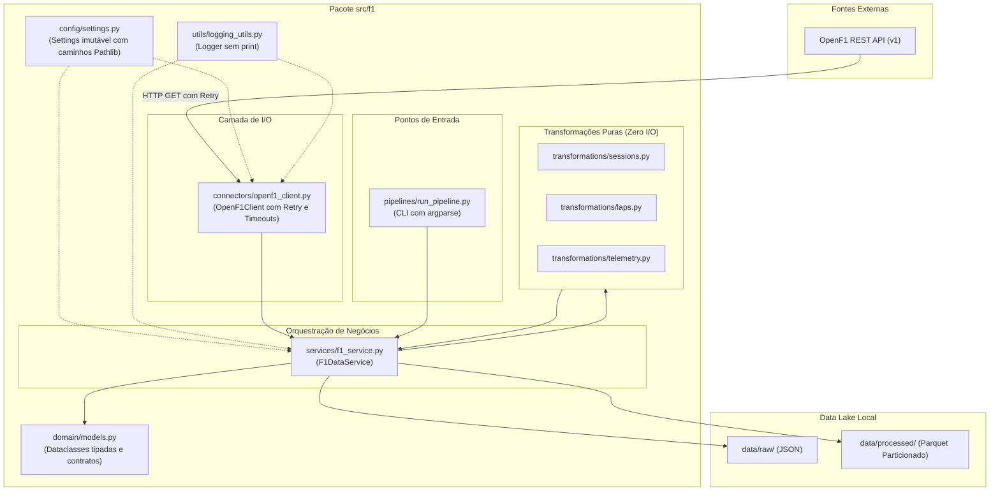

# Arquitetura do Sistema e Fluxo de Dados

A arquitetura do projeto adota o padrão canônico **`src/` Layout**, promovendo isolamento estrito de responsabilidades e direção unidirecional de dependências.

---

## 🏗️ Camadas da Aplicação

---

## 🔒 Regras de Isolamento e Fronteiras Modulares

1. **Transformações Puras (Zero I/O)**:
   - Funções sob `src/f1/transformations/` são 100% determinísticas e puras.
   - Proibido importar bibliotecas de rede (`requests`, `urllib3`) ou realizar operações em disco dentro das transformações.
2. **Conectores Especializados**:
   - Módulos sob `src/f1/connectors/` cuidam exclusivamente de transporte de rede, timeouts explícitos, retries exponenciais e mapeamento de erros HTTP para exceções de domínio (`OpenF1ClientError`).
3. **Modelos de Domínio Tipados**:
   - `src/f1/domain/models.py` define dataclasses imutáveis para as entidades do ecossistema da Fórmula 1 (Meeting, Session, Driver, Lap, TelemetrySample, WeatherSample).
4. **Camada de Serviços (Coordenação)**:
   - `F1DataService` orquestra a extração de dados brutos, a aplicação das transformações e a persistência idempotente colunar em Parquet.
5. **Ausência de Efeitos Colaterais na Importação**:
   - Nenhum módulo dispara conexões de rede ou cria arquivos no momento em que é importado.

